# 📈 Indian Stock Analyst

An open-source dashboard for **NSE/BSE stocks**: pick a category (Nifty 50, Midcap 150, Nifty IT, Pharma, Defence, …),
pick a stock, and get company health, fundamentals, valuation, multi-timeframe technical analysis and an
**AI-written research note** — all as interactive charts. Bring your own AI key (DeepSeek, Gemini, OpenAI, Claude,
Groq, OpenRouter) or run a local model with Ollama for free.

It also ships **`equity-research-india`**, an India-adapted and improved version of Anthropic's
[equity-research Claude plugin](https://github.com/anthropics/financial-services/tree/main/plugins/vertical-plugins/equity-research),
powered by the same engine.

> ⚠️ **Educational research tool — not investment advice.** The authors are not SEBI-registered Research Analysts or
> Investment Advisers. Data can be delayed or wrong. Verify against exchange filings before acting.

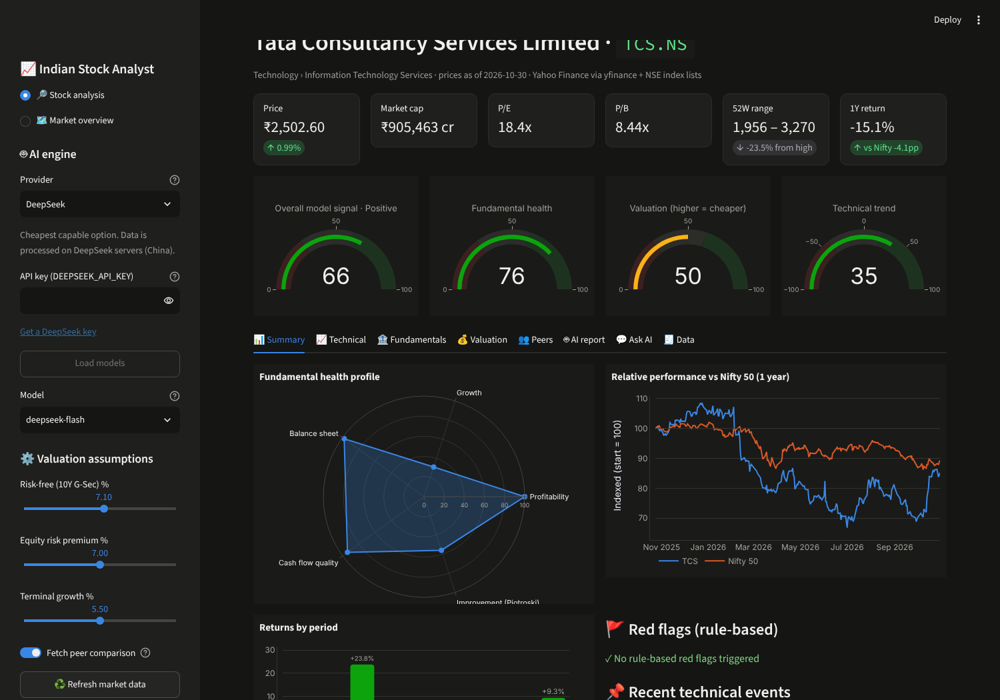

---

## What you get

| Area | What it shows |
|---|---|
| **Market overview** | Category heatmap (colour = return, size = traded value), breadth (advancers, % above 200-DMA, % in uptrend), sortable screener; click a row to analyse it |
| **Scores** | Overall model signal, fundamental health (0–100), valuation (0–100, higher = cheaper), technical trend (−100…+100) — each with its formula visible |
| **Technical** | Candlestick chart with EMA 20/50/200, Supertrend, Bollinger, auto support/resistance, volume, RSI, MACD · timeframes **1H, 4H, Daily, Weekly, Monthly** · trend matrix showing *why* each timeframe is up/down · Fibonacci, regression channel, golden/death crosses, 52-week breakouts, volume spikes, RSI divergence, candlestick shapes |
| **Fundamentals** | Revenue/EBITDA/profit, margins, ROE/ROCE/ROA, profit vs cash flow, debt/equity, working-capital days, quarterly YoY · **Piotroski F-score**, **Altman Z''-EM** (emerging-market variant), rule-based red flags |
| **Valuation** | P/E, EV/EBITDA, P/B, PEG, yields · **football field** · **DCF with WACC × growth sensitivity heatmap** · **reverse DCF** (growth the price already implies) · own P/E history band · justified P/B for banks/NBFCs · peer medians |
| **Ratings by horizon** | Model rating (Strong Buy → Strong Sell) for **1 week, 4 weeks, 3 months, 6 months, 1 year and long term**, each built from the evidence that matters at that horizon (trend & breakouts short-term → earnings momentum → fundamentals & valuation long-term), with confidence, a best-fit-horizon suggestion, entry zone / stop / targets / reward-risk, and a **historical check**: how often this stock actually rose after similar setups vs on any day |
| **Levels & breakouts** | Support and resistance **zones** (price bands, not lines) and breakout patterns on **1H, 4H, 1D and 1W** — zone breakouts with volume confirmation & failed-breakout detection, consolidation ranges, ascending/descending/symmetrical triangles, wedges, channels, double tops/bottoms, trendline breaks, 52-week/all-time-high breakouts, Bollinger squeezes, NR7/inside bars — each with trigger, target and invalidation, drawn on the chart |
| **News & results** | NSE exchange filings (tagged: results, orders, M&A, fund raising, promoter/pledge/SAST, ratings, management, legal), alerts for filings that need attention, next results date (event risk), board meetings, dividends/bonus/splits, Google News (India) headlines, latest quarterly results |
| **IPO centre** | Every open and announced IPO on NSE (mainboard + SME) with price band, lot size, minimum investment, issue size, fresh issue vs offer-for-sale, lead managers and registrar · **live subscription by investor category** (QIB, NII, retail) · a rule-based listing-gain scorecard · the company's restated financials **read from the Red Herring Prospectus** (every figure checked against the prospectus text; P/E, margins, ROE, debt/equity and post-issue market cap computed in code) · an AI view with three verdicts: **apply for listing gains**, **short-term holding** and **long-term holding** · how recent IPOs listed and have done since |
| **Breakout scanner** | Scans ~750 stocks every day for strong stocks pressing against their 20-day high **before** they close above it (rules, presets and filters by cap and sector are adjustable), with a chart per candidate · a built-in **backtest** of the same rules on 3/5/7 years of history: how often a signal broke out within 10 sessions and how often cleanly (+10% without failing), against all stocks near their highs, year by year · the rules exported as a **Chartink** scan. On 2024–26 data the default rules broke out ~70% of the time and cleanly ~1 time in 3 (vs ~40% / ~16% for any stock near its high), so two in three picks still fail or stall. The textbook "tight base / volume drying up" setup is included as a preset so you can see it test worse |
| **Stock search** | Type a company name, NSE symbol, old symbol or former name in any case (`borosil`, `sbi`, `Zomato`, `vedant fashions`, `relaince`). It covers every NSE mainboard and SME stock (~3,200), 500+ old symbols and ~700 former names from NSE's own change lists, everyday short forms (SBI, HUL, L&T, RIL) and small typos. When the text fits several companies (there are three Borosils) you pick one instead of getting an error |
| **Stock universe** | All ~750 Nifty Total Market stocks classified by **NSE sector, finer industry, market-cap bucket (large/mid/small/micro) and index membership**; filter and browse as a sector → industry → stock map |
| **Peers** | Same-industry companies (NSE classification) on a P/E vs ROE bubble map + table |
| **AI report** | Verdict, health, fundamentals, valuation, technical view per timeframe, bull/bear case, catalysts, India-specific risks, what would change the view, quarterly checklist, data gaps · every claim tagged **[DATA] / [INFERENCE] / [ASSUMPTION]** · **number audit** flags any figure the AI wrote that is not in the data · download as HTML (with charts) or Markdown |
| **Ask AI** | Chat about the stock; answers grounded in the same data |

| Market overview | Technical | Valuation |
|---|---|---|
| 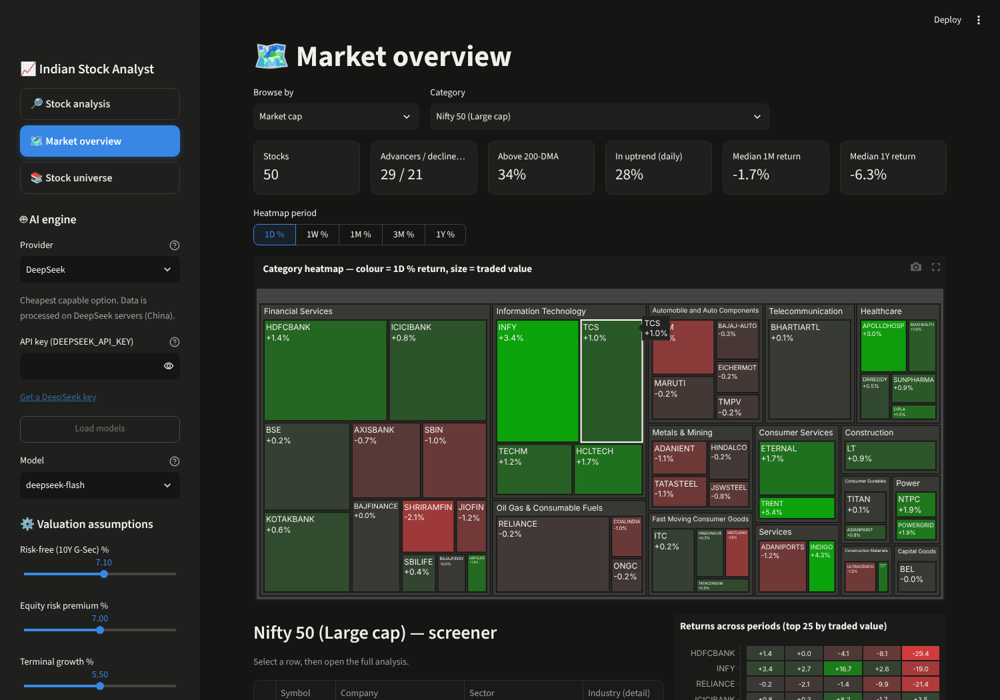 | 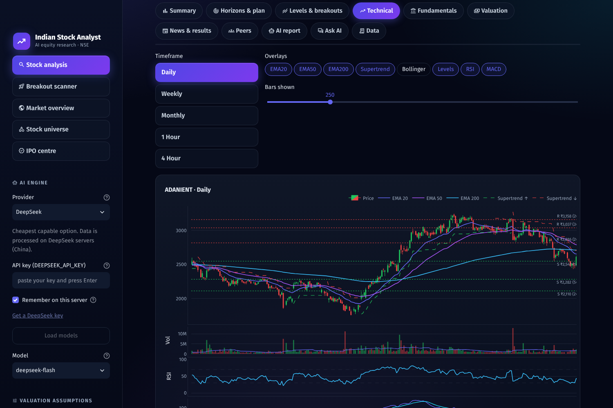 | 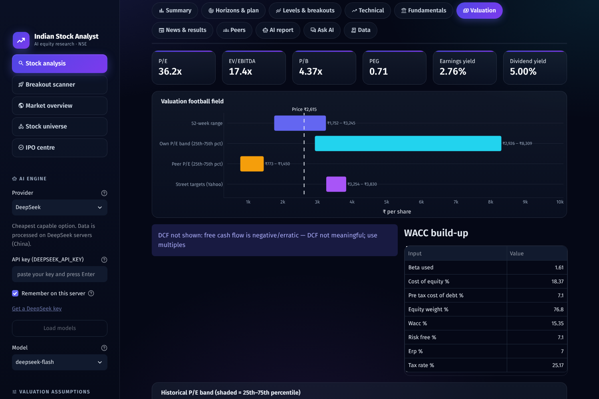 |
| **Trend matrix** | **Fundamentals** | **Peers** |
| 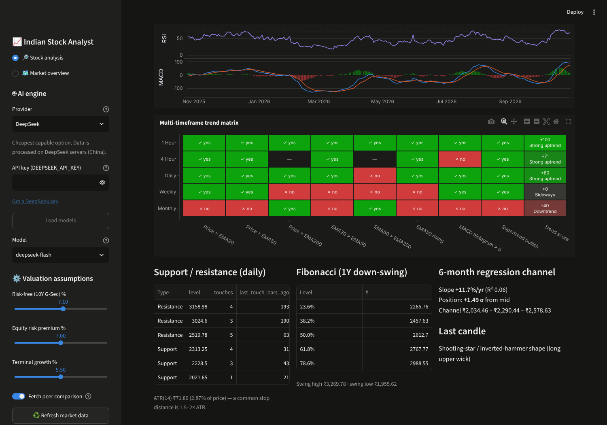 | 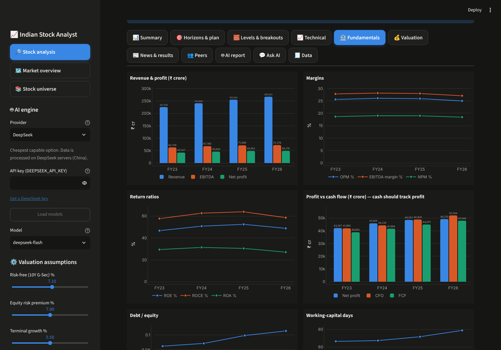 | 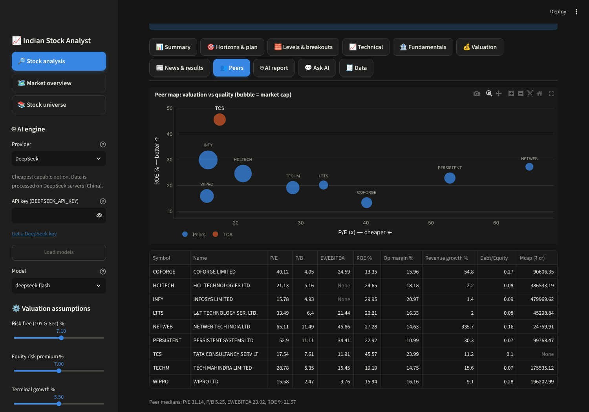 |
| **Ratings by horizon** | **Horizons & historical check** | **Levels & breakouts** |
| 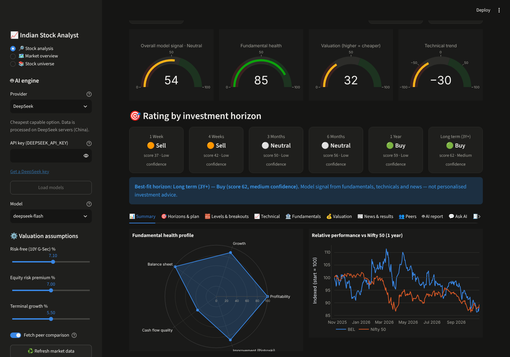 | 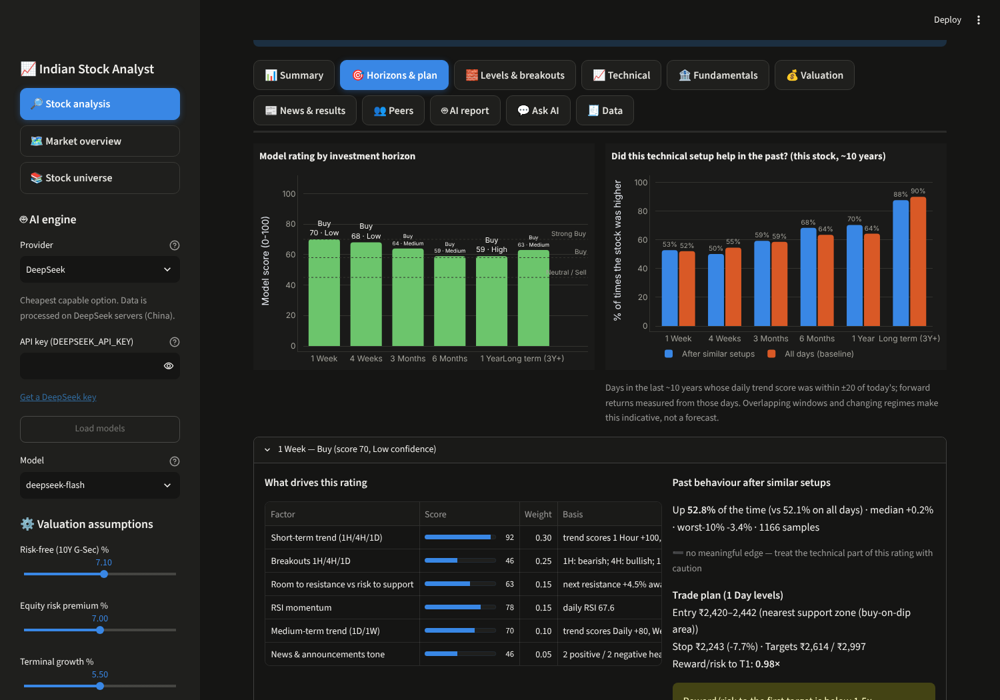 | 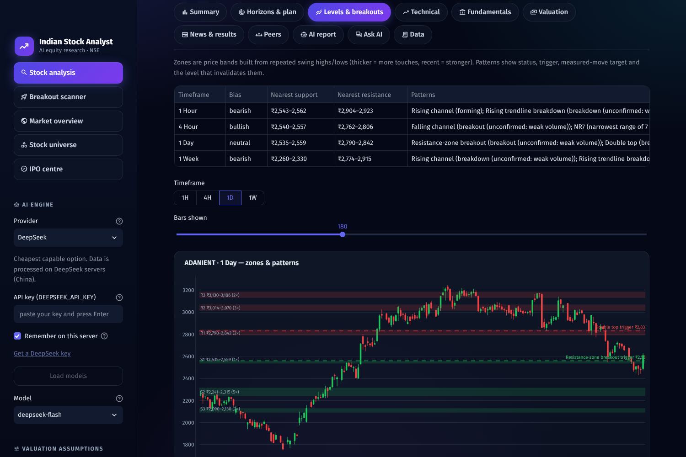 |
| **News & results** | **Stock universe** | **IPO centre** |
| 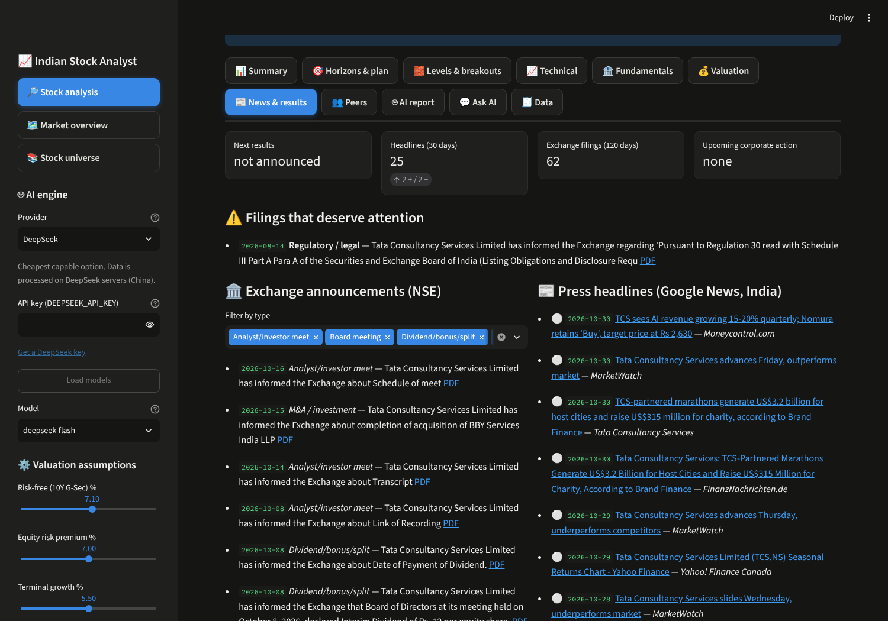 | 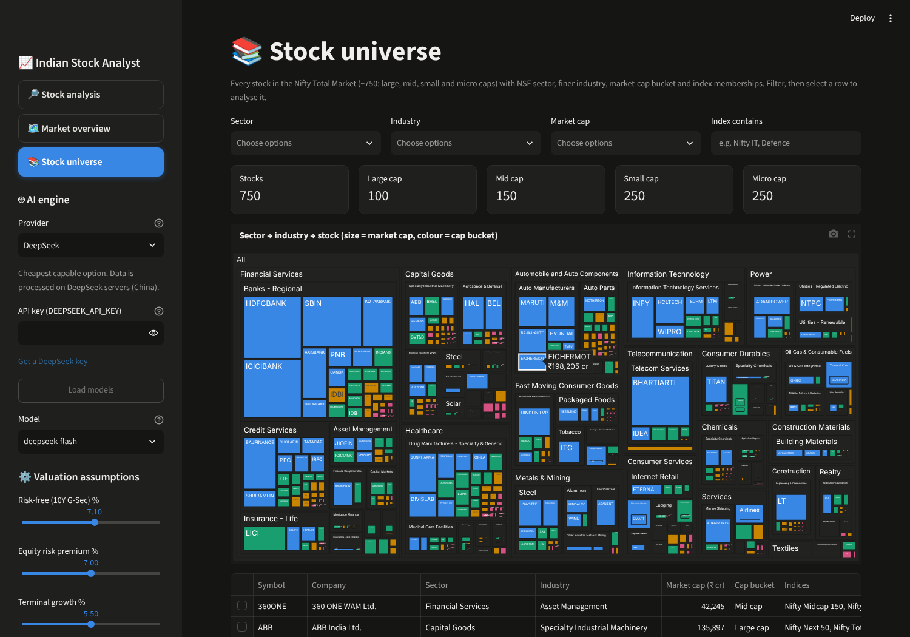 | 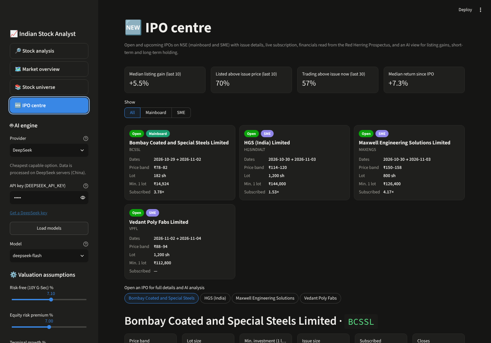 |
| **Breakout scanner** | **Scanner backtest** | |
| 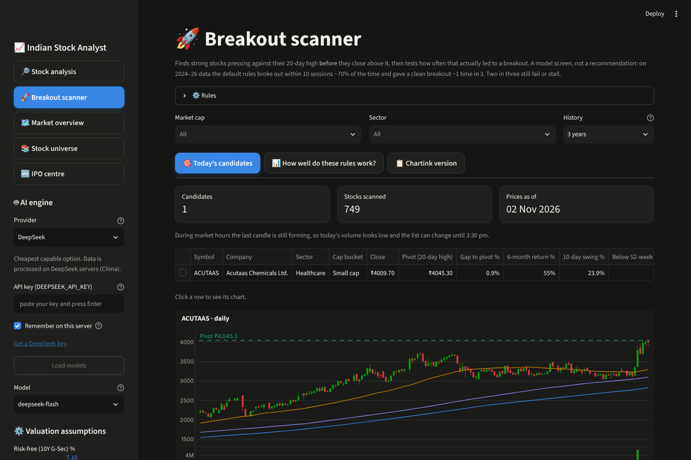 | 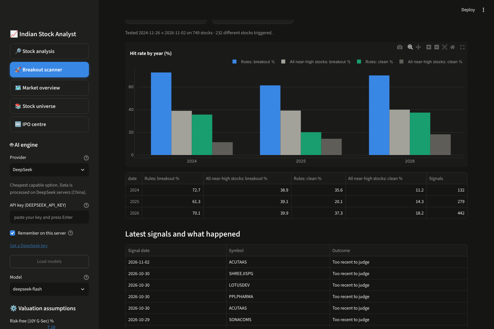 | |

*Screenshots use live data (Yahoo Finance, NSE, Google News) from 2 Nov 2026 and are illustrations, not views on any stock.*

### About the ratings — read this once
- They are a **transparent model signal**, not personalised advice. Every rating shows its inputs, weights and
  the past behaviour of the same setup on that stock. The AI may move a rating by at most one notch and must say why.
- **Short horizons are mostly noise.** A 1-week rating is never shown with high confidence. On many large caps the
  historical check shows that a "good" technical setup rose about as often as any random week — when it does, the
  dashboard says so.
- Upcoming quarterly results inside a horizon are flagged: the rating can flip on the numbers.
- If you share these ratings with others as recommendations, SEBI's Research Analyst rules apply to you.

### Why the numbers can be trusted more than a chatbot's
Every ratio, score, level and DCF is **computed in Python** (`isa/`). The AI only receives that "fact pack"
(see the *Data* tab) and must tag every claim. A post-check then compares each number in the AI's note against
the data and warns you about anything it cannot trace. LLMs are good at explaining numbers and bad at producing them —
the design takes that seriously.

---

## Quick start (step by step)

You need **Python 3.10 or newer** and **Git**. No programming required.

### Windows
1. Install Python from <https://www.python.org/downloads/> — tick **"Add python.exe to PATH"** during setup.
2. Install Git from <https://git-scm.com/download/win>.
3. Open **Command Prompt** and run:
   ```bat
   git clone https://github.com/n00bsniper2024/Indian_stock_Analyst.git
   cd Indian_stock_Analyst
   scripts\install.bat
   scripts\run.bat
   ```
4. Your browser opens at <http://localhost:8501>.

### Linux / macOS
```bash
git clone https://github.com/n00bsniper2024/Indian_stock_Analyst.git
cd Indian_stock_Analyst
bash scripts/install.sh
bash scripts/run.sh
```
Open <http://localhost:8501>.

### On a remote Linux server through VS Code (Remote-SSH)
1. In VS Code's terminal (connected to the server) run the Linux commands above.
2. VS Code detects port **8501** and shows *"Open in Browser"* — click it. If it doesn't, open the **Ports** panel
   (View → Ports), click **Forward a Port**, type `8501`, then open the local address it shows.
3. The app listens on `localhost` only by default, so it is not exposed to the internet — keep it that way unless you
   add authentication.

### Run it permanently (no terminal needed)

`run.sh` only works while that terminal stays open. To have the dashboard always available, install it as a
background service once — it then starts on every boot and restarts itself if it crashes.

**Linux (systemd — most servers and desktops):**
```bash
bash scripts/install-service.sh
```
That's it. Useful commands afterwards:

| Task | Command |
|---|---|
| Is it running? | `sudo systemctl status indian-stock-analyst` |
| See live logs | `journalctl -u indian-stock-analyst -f` |
| Restart (e.g. after editing `.env`) | `sudo systemctl restart indian-stock-analyst` |
| Get the latest version | `bash scripts/update.sh` (pulls, updates packages, restarts) |
| Remove the service | `bash scripts/uninstall-service.sh` |

**Windows:** run `scripts\install-autostart.bat` once — the dashboard then starts hidden at every login
(undo with `scripts\remove-autostart.bat`). macOS: use `bash scripts/run.sh` or a LaunchAgent.

#### Opening it from another computer (e.g. your laptop, when the app runs on a server)
The service keeps the *app* running, but VS Code's port forwarding only works while VS Code is connected.
Pick one way to reach it without VS Code:

| Option | How | Security |
|---|---|---|
| **SSH tunnel** (recommended, nothing exposed) | on your laptop: `ssh -N -L 8501:localhost:8501 user@your-server`, then open <http://localhost:8501> | only you, via your SSH login |
| **Tailscale** (just open a URL, any device) | install [Tailscale](https://tailscale.com) on server + laptop/phone, then `bash scripts/install-service.sh --address <server's 100.x Tailscale IP>` | private network + app password |
| **Your LAN** | `bash scripts/install-service.sh --address 0.0.0.0`, allow port 8501 only from your laptop's IP in the server firewall | app password; never port-forward this to the internet |

Whenever `--address` is not `localhost`, the installer adds a random `ISA_PASSWORD` to `.env` and the dashboard asks
for it — because anyone who can open the page can spend the API credits in your `.env`. Streamlit itself has no login,
and this password gate is basic protection for a private network, not for the open internet.

### Try it without internet or keys
```bash
bash scripts/run.sh --demo        # Windows: scripts\run.bat --demo
```
Demo mode uses synthetic data (clearly labelled) so you can explore the interface.

---

## Adding your AI key

1. Get a key from your chosen provider (links below).
2. Paste it into the sidebar and press **Enter**. With **Remember on this server** ticked (default) it is saved in the
   project's `.env` file (readable only by your user) and survives refreshes and restarts. The browser only ever shows
   the last 4 characters; use **Replace** or **Remove** in the sidebar to change it. Untick the box to keep a key for
   the current browser tab only.
3. In the sidebar click **Load models**, pick a model, open a stock, go to **🤖 AI report → Generate**.

`.env` is git-ignored — never commit keys or paste them into issues.

### Which AI provider?

| Provider | Cost (indicative) | Strength | Get a key |
|---|---|---|---|
| **DeepSeek** (default) | cheapest — `deepseek-flash` listed at ~$0.15 / 1M input and ~$0.60 / 1M output tokens off-peak (Oct 2026); a report uses roughly 6–8k input + 3k output tokens, i.e. a fraction of a rupee | good structured analysis per rupee | [platform.deepseek.com](https://platform.deepseek.com/api_keys) |
| **Google Gemini** | free tier (rate-limited), then pay-as-you-go | fast; free to start | [aistudio.google.com](https://aistudio.google.com/apikey) |
| **Anthropic Claude** | higher | most careful reasoning on financial nuance, fewer unsupported claims | [console.anthropic.com](https://console.anthropic.com/settings/keys) |
| **OpenAI** | mid | strong all-rounder | [platform.openai.com](https://platform.openai.com/api-keys) |
| **Groq** | free tier | very fast open models | [console.groq.com](https://console.groq.com/keys) |
| **OpenRouter** | varies | one key, hundreds of models | [openrouter.ai](https://openrouter.ai/keys) |
| **Ollama** (local) | free | private — nothing leaves your PC; quality depends on model size (14B+ recommended) | [ollama.com](https://ollama.com/download) |

Honest guidance: DeepSeek is a sensible default for cost. If you will act on the output, generate the note with two
different providers and compare — disagreements between models are where your own checking is most needed.
DeepSeek processes requests on servers in China; the fact pack only contains public market data, but keep that in mind
if you paste anything personal into the chat.

Model names change often, so the app lists them live from each provider (**Load models**) instead of hard-coding them.

---

## Data sources and their limits (read this)

| Data | Source | Limit |
|---|---|---|
| Prices (daily since listing, hourly for 60 days) | Yahoo Finance via [`yfinance`](https://github.com/ranaroussi/yfinance) | free; quotes may be delayed; Yahoo throttles bursts — the app caches on disk and backs off |
| Financial statements | Yahoo Finance | only ~4–5 years annual and ~5 quarters; no point-in-time stamps |
| Index constituents & industries | NSE public CSVs (`nsearchives.nseindia.com`) | refreshed weekly; bundled Nifty 50 fallback if NSE is unreachable |
| Exchange filings, board meetings, corporate actions | NSE public APIs | NSE blocks some cloud/datacenter IPs — works from home/office connections; the app says when a feed failed |
| News headlines | Google News RSS (India edition) | headlines only; aggregator numbers can conflict — filings come first |
| Industry / cap classification | NSE index files + Yahoo industry, snapshot in `data/classification.csv` | refresh with `python -m isa.cli refresh-classification` (~10 min) |
| IPOs: issues, subscription, prospectus | NSE public IPO APIs + NSE archives (RHP) | SME issues listed only on BSE are not covered; grey-market premium (GMP) is deliberately excluded — unofficial and unverifiable |
| Shareholding / promoter pledge | **not available** as numbers | pledge/SAST *filings* are flagged from NSE announcements | Yahoo "insiders %" is shown only as a promoter proxy — check NSE/BSE shareholding filings |
| Bank metrics (NIM, GNPA, CASA, CAR) | **not available** | bank scores use ROE/ROA/growth/P/B only |

**Built-in data checks.** Yahoo's Indian fundamentals have real defects — e.g. reported EPS not adjusted for bonus
issues (HDFC Bank's 2025 1:1 bonus), skipped quarters, implausible multiples (EV/EBITDA > 1,000×), consolidated vs
standalone book value mismatches. The engine recomputes EPS from adjusted share counts, compares quarters by date
(never by row position), drops implausible peer multiples, and shows a yellow warning whenever its own numbers disagree
with Yahoo's quoted fields. Treat any warned metric as unverified. Two structural caveats: peers come from NSE's broad
industry buckets (banks are matched with banks), and groups with lending arms (e.g. M&M) show weak consolidated cash
conversion because loan growth counts as an operating outflow.

`yfinance` is meant for personal research and education; respect Yahoo's and NSE's terms of use. If you need
licensed, redistributable data, swap `isa/data.py` for a paid provider (NSE Data & Analytics, TrueData, broker APIs).

Default valuation inputs (editable in the sidebar): risk-free 7.1% (India 10Y G-Sec was ~7.18% on 28-Sep-2026),
equity risk premium 7.0%, terminal growth 5.5%, tax 25.17% (Sec 115BAA).

---

## Claude plugin: `equity-research-india`

Seven skills — `/analyze`, `/initiate`, `/results`, `/screen`, `/sector`, `/catalysts`, `/thesis` — adapted from Anthropic's
equity-research plugin for Indian markets. What changed and why is documented in
[`equity-research-india/README.md`](equity-research-india/README.md). Use it in Claude Code from the repo root:
```bash
claude --plugin-dir ./equity-research-india
```

## Command line
```bash
python -m isa.cli analyze TCS                    # full fact pack as JSON
python -m isa.cli categories                     # list categories
python -m isa.cli category "Nifty IT"            # screener table
python -m isa.cli report INFY --provider DeepSeek --model deepseek-flash --out infy.md
```

## Docker
```bash
docker build -t indian-stock-analyst .
docker run -p 8501:8501 --env-file .env indian-stock-analyst
```

## Hosting it for others (Streamlit Community Cloud)
Fork the repo → <https://share.streamlit.io> → New app → `app.py`. Leave keys out of the repo; each visitor pastes
their own key in the sidebar, or the owner adds keys under *App settings → Secrets* (then **anyone with the link spends
the owner's credits** — add authentication first). All visitors share one IP for Yahoo requests, so expect rate limits.

---

## Project layout
```
app.py                     Streamlit dashboard
isa/
  universe.py              NSE categories (live CSVs + fallback)
  data.py                  Yahoo data, disk cache, rate-limit back-off   (demo.py = synthetic data)
  technicals.py            indicators, multi-timeframe trend, levels, events
  fundamentals.py          ratios, Piotroski, Altman Z''-EM, red flags, health score
  valuation.py             multiples, P/E band, DCF + reverse DCF, justified P/B, peers, football field
  analysis.py              builds the fact pack (the only thing the AI sees)
  scanner.py               breakout scanner, its backtest and Chartink export
  search.py                stock search (names, old symbols, short forms, typos)
  llm.py / ai.py           provider-agnostic LLM client, report generation, number audit
  charts.py / report.py    Plotly charts, HTML/Markdown export
  cli.py                   command line
prompts/                   analyst system prompt, report schema, Q&A prompt — edit to change the AI's behaviour
equity-research-india/     Claude plugin (skills + commands)
tests/                     pytest suite (runs offline on synthetic data)
```

## Troubleshooting
| Problem | Fix |
|---|---|
| "Yahoo Finance is rate-limiting" | wait a few minutes; cached data is reused; avoid re-loading large categories repeatedly |
| Category shows only 50 stocks / "bundled snapshot" warning | NSE blocked the request (common on cloud servers); it retries next week or after **Refresh market data** |
| `No price data … (.NS or .BO)` | type the company name in the search box instead of a guessed symbol; the dashboard lists the matching companies (old symbols like `BOROSIL` and renamed companies like Zomato → `ETERNAL` are mapped) |
| AI error about the model | click **Load models** and pick one from the live list |
| Dashboard stops when I close the terminal or VS Code | install it as a service: `bash scripts/install-service.sh`, and open it via an SSH tunnel or Tailscale (see "Run it permanently") |
| `streamlit: command not found` | activate the environment first: `. .venv/bin/activate` (Windows: `.venv\Scripts\activate`) |

## Contributing
Run `pytest -q` (works offline). Keep all arithmetic in `isa/`, never in prompts.

## License
Apache-2.0. Portions adapted from Anthropic's financial-services repository — see [NOTICE](NOTICE).
